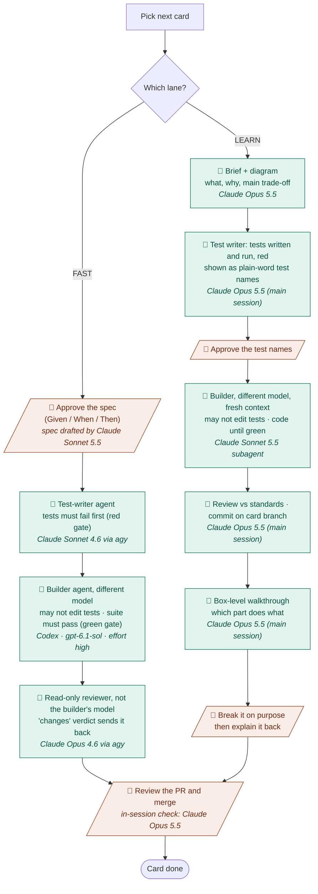

# PayPulse

Synthetic B2B invoicing + buy-now-pay-later platform with its own risk and observability side.
A gamified interview-prep project: every level closes a real gap found in job applications.
All data is synthetic. Not a real financial product.

Plan, architecture and game rules live in the second-brain note
`01-projects/paypulse/plan.md`.

## Layout

```
pom.xml                    parent POM: Java 21, Spring Boot 4 + Spring Cloud 2025.1 BOMs, module list
platform/common-web        shared web library (errors, correlation id), no business logic
services/api-gateway       Spring Cloud Gateway, port 8080
services/customer-service  customers and tenants, port 8082
```

## Build and run

```bash
mvn -q verify                                      # build + test everything
mvn -pl services/customer-service spring-boot:run  # run one service
```

Requires Java 21 and Maven 3.9+. Shortcuts (`make help` lists them; Java 21 is pinned for you):

```bash
make up                       # infra profile (Postgres, Redis); PROFILE=messaging|identity|obs|apps for the others
make dev SERVICE=customer     # run one service from Maven (customer or gateway)
make test                     # build and test everything
make logs SERVICE=kafka       # follow one container's logs
make down                     # stop everything, data kept
```

The Makefile has its own tests: `scripts/test-makefile.sh` (dry run, finishes in a second).

## Local infrastructure

```bash
cd infra/compose
cp .env.example .env    # first time only
docker compose --profile infra --profile messaging --profile identity --profile obs up -d
```

Each group is a Compose profile, so you can start only what you need (for example `--profile infra`).

| Port | Service | Profile | URL / address |
|------|---------|---------|---------------|
| 5432 | PostgreSQL 16 | infra | `jdbc:postgresql://localhost:5432/paypulse` |
| 6379 | Redis | infra | `redis://localhost:6379` |
| 9092 | Kafka (KRaft, single node) | messaging | `localhost:9092` (containers: `kafka:19092`) |
| 5672 | RabbitMQ (AMQP) | messaging | `amqp://localhost:5672` |
| 15672 | RabbitMQ management | messaging | http://localhost:15672 |
| 8085 | Redpanda Console (Kafka UI) | messaging | http://localhost:8085 |
| 8180 | Keycloak | identity | http://localhost:8180 |
| 3000 | Grafana (otel-lgtm) | obs | http://localhost:3000 |
| 4317 | OTLP gRPC (otel-lgtm) | obs | `http://localhost:4317` |
| 4318 | OTLP HTTP (otel-lgtm) | obs | `http://localhost:4318` |
| 8080 | api-gateway (container) | apps | http://localhost:8080 (bound to 127.0.0.1 only) |
| 8082 | customer-service (container) | apps | http://localhost:8082 (bound to 127.0.0.1 only) |
| 5005 | customer-service debug (JDWP) | apps | attach IntelliJ "Remote JVM Debug" to `localhost:5005` |
| 5006 | api-gateway debug (JDWP) | apps | attach to `localhost:5006` |

Credentials come from `infra/compose/.env`. Keycloak is on 8180 so it does not clash with the gateway on 8080.

## Debugging

Two modes, full walkthrough in `docs/guides/l0-6-debug-modes.md`.
- **Mode B (daily):** `docker compose --profile infra up -d`, run one service from IntelliJ with the bug icon.
- **Mode A (same as Docker):** `mvn -q package jib:dockerBuild -DskipTests`, then
  `docker compose --profile infra --profile apps up -d`, then attach IntelliJ to port 5005 (gateway: 5006).
- Always pass **both** `--profile infra --profile apps`: the apps depend on `postgres`, which lives in `infra`.
- Debug ports are published on `127.0.0.1` only: a debug port lets whoever reaches it run code in the JVM.
- After a code change in Mode A, rebuild the image, otherwise the container runs the old jar.

## How this project is built (TDD workflow)

Every change is **test-first**: the tests are written and shown failing (red) before any code exists, and the code is done only when they pass (green).
The code is written by AI. The human designs, approves the tests, reviews, breaks the system on purpose, and decides what gets merged.

Each task card takes one of two lanes:

- **⚡ FAST** for boilerplate and plumbing. A software-factory harness (my own, to be published separately) runs the TDD loop and enforces it in code: one agent writes the tests, a second agent writes the code but may not touch the tests, and a third reviews it read-only. Nothing merges by itself.
- **🧠 LEARN** for the core ideas (ledger, agent, Kubernetes, messaging). This lane runs in an interactive session in "architect mode": the focus is structure, trade-offs and failure modes, not syntax.



👤 = human decision · 🤖 = AI work. Rules that never change: no code before a failing test, tests are never weakened to make code pass, nothing is committed to `main` directly, and every non-trivial decision becomes an ADR in `docs/adr/`.

### Which model does what

**Rule: the test writer and the builder are never the same model.** A model that writes both the tests and the code grades its own homework; a different model (in a fresh context) can only move the code toward tests it didn't write. The reviewer is also never the builder's model.

| Step | Tool | Model | Why this one |
|---|---|---|---|
| FAST test writer | software-factory via `agy` (`runtimePreset: ash-pipeline`) | Claude Sonnet 4.6 | Turns each acceptance criterion into a failing test |
| FAST builder | software-factory via Codex CLI | `gpt-6.1-sol`, reasoning effort high | Different model family from the test writer; strong at plumbing code |
| FAST reviewer | software-factory via `agy`, read-only | Claude Opus 4.6 | Not the builder's model; JSON verdict, a serious finding overrides "pass" |
| LEARN brief, design, test writer | Claude Code main session | Claude Opus 5.5 | Design, trade-offs and what to test are where the strongest model pays off |
| LEARN builder | Claude Code subagent, fresh context | Claude Sonnet 5.5 | Different model from the test writer; may not edit tests |
| LEARN review, walkthrough, PR check | Claude Code main session | Claude Opus 5.5 | Not the builder's model; explains the result at box level |

Model names change often. The FAST lane reads them from the factory preset and `~/.codex/config.toml`; update this table when they change. Codex is used while its free month lasts (to about 2026-11-27); after that, cards run in the LEARN lane.

## Status

L0 Spawn done (scaffold, Compose infrastructure, customer-service, api-gateway, debug modes, Makefile). L1 Ledger Keeper in progress: ledger schema + ADR-001 done. Next: ledger REST plumbing (factory), then money rules.
