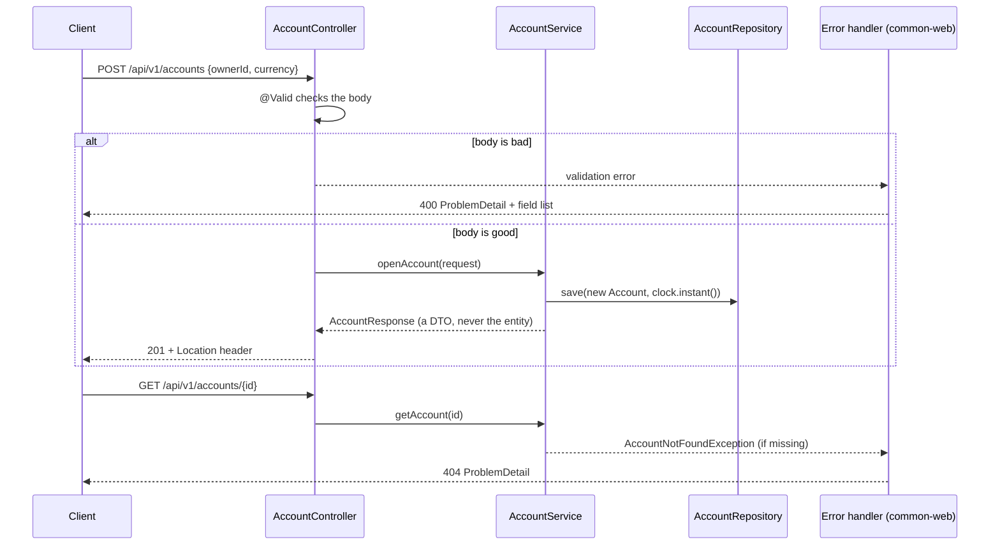

# F1: Ledger REST plumbing (diagram and lesson box)

## Lesson box (12-year-old)
- **Idea:** the ledger now has a front door, and the door answers every question politely, even a silly one.
- **Like:** a shop counter. If you ask for something that doesn't exist, the clerk says "we don't have that" in a clear note. They never faint and never show you the back room.
- **Picture:** the diagram above.
- **Explain-back:** Why does the controller only pass the request on and never make decisions itself?

## Break it
`scripts/break-it-f1.sh` (needs Docker and Java 21). It starts a throwaway Postgres and the real service, sends one good and five bad requests. Every bad one gets a clean 400 or 404 explanation, never a 500.

## How F1 was built
LEARN lane: tests written first (Sonnet 5.5), code built by a separate Opus subagent that was not allowed to edit the tests.
The FAST factory run failed because the agy test-writer stalled on a blocked terminal command; fixed in software-factory `9c6134d`.
