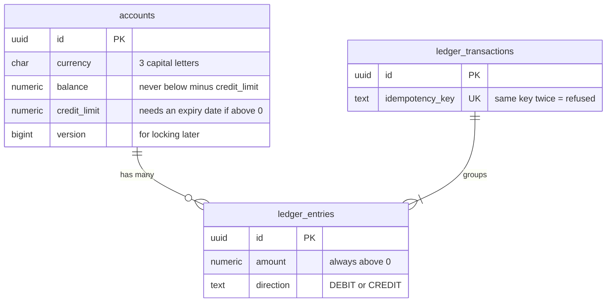

# L1-1: Ledger schema (diagram and lesson box)

`ledger_entries` and `ledger_transactions` are append-only: a trigger refuses every UPDATE and DELETE.

## Lesson box (12-year-old)
- **Idea:** the database itself refuses bad money records, and old records can never be changed.
- **Like:** a shop's receipt book written in pen. You can add a page, but you can't erase one. To fix a mistake you write a new page that cancels it.
- **Picture:** the diagram above.
- **Explain-back:** Why is it easier to trust a ledger where nobody can edit old entries?

## Break it
`scripts/break-it-l1-1.sh` (needs Docker). Six cheating attempts, all refused.
